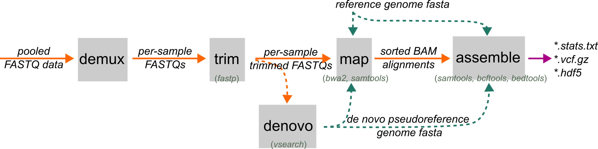

# assemble

`ipyrad2 assemble` takes mapped BAM files and a reference (or pseudoreference) genome fasta and generates
a the main project outputs:
final assembled loci, a filtered VCF, a loci BED, a human-readable stats report, and
an HDF5 database that can be used by downstream export and analysis commands.

This is the normal next step after [`map`](./map.md), but it is also a valid entry point if you
already have trusted mapped BAMs from another workflow.

{ width="100%" }


## When to Use

Use `assemble` when you already have mapped BAM files against a reference or denovo pseudoreference
and you are ready to define loci, call variants, and write final project outputs.


Use cases fall into three modes:

- standard RAD assembly: RAD BAMs define loci and are assembled
- mixed RAD/WGS assembly: RAD BAMs define loci, and WGS BAMs contribute genotype and coverage information inside those same loci
- explicit BED assembly: `--loci-bed` supplies loci directly, so `assemble` skips RAD-based locus delimiting

If no RAD BAMs are available, `assemble` still works, but only when `--loci-bed` is provided and at least one BAM file is supplied.

## Prerequisites

- mapped BAM files, usually from [`map`](./map.md)
- the same reference FASTA or denovo pseudoreference used during mapping

The BAMs do not need to come only from ipyrad2, but they do need to be coordinate-consistent with the
reference you provide here.

<!--
## Inputs and Workflow Logic

### Core inputs

- `-d, --rad-bams`: RAD BAM inputs
- `-w, --wgs-bams`: optional WGS BAM inputs
- `-r, --reference`: reference FASTA reused for locus extraction, consensus writing, and variant calling
- `-b, --loci-bed`: optional BED of loci to assemble instead of delimiting them from RAD BAMs

The workflow logic is:

- if `--loci-bed` is not provided, RAD BAMs are required because they define the shared loci
- if `--loci-bed` is provided, `assemble` uses that BED directly and skips RAD-based locus delimiting
- WGS BAMs never define loci on their own unless a loci BED is supplied explicitly

That last point matters. The WGS addition is powerful because it lets whole-genome samples join a
RAD-defined assembly, not because `assemble` has become a general-purpose whole-genome locus-discovery tool.

### Sample naming and grouping

- `--subsample`: first-column table selecting BAM filenames or sample names
- `--rename`: two-column table mapping BAM basenames to final sample names
- `-p, --populations`: grouped-calling populations file
- `-x, --masks`: optional sequence patterns to mask in the final assembled sequences

`--subsample` reads only the first column and ignores additional columns. It can match literal BAM filenames or resolved sample names, so the same sample-mapping table can often be reused across selection and grouping steps.

`--rename` overrides BAM-header names for listed inputs. This is the clean way to normalize names before grouped calling, final outputs, and downstream analysis.

`--populations` is used for grouped calling only. If the file also includes classic per-population minmap thresholds, `assemble` currently ignores those thresholds and uses the file only to define grouped-calling sample groups.

`--masks` affects the final assembled sequences. It does not change locus discovery.
 -->
## What `assemble` does

1. It filters BAM inputs based on parameter thresholds to remove low quality mappings.
2. It delimits loci from shared coverage BEDs among RAD sample BAMs, or loads them directly from `--loci-bed`.
3. It runs within-sample and across-sample paralog filtering to define the final set of loci BEDs.
4. It jointly calls variants inside those loci and applies project-wide genotype and site filters.
5. It builds consensus sequences, writes final loci and BED outputs, a filtered VCF, and a HDF5 database file.

## Command Patterns

The smallest standard RAD assembly is:

```bash
ipyrad2 assemble -d BAMS/RAD/*.bam -r REF.fa -o OUT
```

### Core Inputs

- `-d, --rad-bams`: RAD BAM inputs that delimit loci unless `--loci-bed` is provided
- `-w, --wgs-bams`: optional WGS BAMs assembled only inside RAD-defined loci or inside loci from `--loci-bed`
- `-r, --reference`: reference FASTA used for mapping and reused here
- `-b, --loci-bed`: explicit loci BED instead of RAD-based locus delimiting
- `-n, --name`: output prefix, default `assembly`
- `-o, --out`: output directory, default `./OUT`

### Mapped-Read Filters

These filters are applied when `assemble` prepares its analysis BAMs:

- `-qm, --min-map-q`: minimum MAPQ retained in analysis BAMs
- `-ms, --max-softclip`: maximum allowed soft-clipped bases
- `-me, --max-nm`: maximum allowed NM edit distance
- `-mt, --max-tlen`: maximum absolute TLEN for paired-end reads

These settings can strongly affect downstream locus retention. Overly strict values can make good data disappear before locus delimiting even begins.

### Locus BED Delimiting

These settings matter only when loci are being delimited from RAD BAMs:

- `-m, --min-locus-sample-coverage`: minimum number of RAD samples required to retain a locus
- `-z, --min-locus-length`: minimum locus length after delimiting
- `-g, --min-locus-merge-distance`: merge nearby coverage intervals within this distance

WGS samples do not help a locus pass `-m`. In mixed RAD/WGS runs, RAD BAMs define the loci first, and WGS samples are assembled only inside loci that already passed the RAD-based delimiting step.

If `--loci-bed` is provided, `assemble` ignores these RAD-delimiting controls.

### Locus and Variant Filters

- `-qb, --min-base-q`: minimum base quality used during mpileup and related calling steps
- `-qs, --min-site-q`: minimum site QUAL for retained variant sites
- `-qg, --min-geno-q`: minimum per-sample genotype quality
- `-s, --min-sample-depth`: minimum within-sample depth to keep a genotype instead of masking it
- `--min-sample-observed-fraction`: minimum fraction of non-`N`, non-gap bases required to keep one sample in one final locus
- `-u, --max-locus-hetero-frequency`: maximum fraction of samples heterozygous at one site before the locus is considered paralog-like
- `-y, --max-locus-variant-frequency`: maximum fraction of sites in a locus that can be variant before filtering
- `-a, --min-locus-trim-sample-coverage`: minimum number of samples with non-`N` calls required to keep positions at locus edges

These settings control what survives into the final `.loci`, `.vcf.gz`, and `.hdf5` outputs. In particular, `--min-sample-observed-fraction` removes sample rows that are mostly missing after trimming and depth/genotype masking, while `--max-sample-hetero-frequency` separately targets rows with too many heterozygous observed bases.

### Paralog Filters

`assemble` has an explicit paralog-scoring stage. The current controls are:

- `--depth-z-max`
- `--softclip-len-threshold`
- `--softclip-frac-max`
- `--third-frac-cut`
- `--min-3allele-sites`
- `--maf-threshold`
- `--max-sites-above-maf`
- `--paralog-fail-frac-max`
- `--max-sample-hetero-frequency`

loci can be flagged as paralog-like by unusually deep coverage, unusually clipped reads, strong third-allele evidence,
or excess allelic variation. Those signals are evaluated within samples and then reduced across samples before the
final shared BED is accepted.

### Sample Naming, Grouping, and Masks

- `--subsample`: select a subset of BAMs by filename or sample name
- `--rename`: rename final sample names from BAM basenames
- `-p, --populations`: grouped-calling populations file
- `-x, --masks`: site-pattern masks applied in the final assembled sequences

Use these when you need grouped calling, stable sample names that differ from BAM headers, or post-consensus masking of known sequence patterns.

### Performance and Overwrite

- `-c, --cores`: maximum total cores, default `6`
- `-t, --threads`: threads per multithreaded job, default `3`
- `-f, --force`: overwrite assemble outputs for this run

`assemble` uses both multithreaded tools and pooled job stages, so `cores` and `threads` together determine how much parallel work can happen at once.

Joint calling submits the larger existing BED chunks first, with the same chunk
boundaries and concurrency limit (`cores // threads`). Increasing capture
concurrency can substantially increase memory use because each capture reads
every sample's BAM.

For `--evidence loci`, native records are parsed in ordered batches while a single
process writes the HDF5 database. Large panels use up to
`min(2, max(1, cores - 2))` parser workers, reserving capacity for the writer and
native input stream. Panels smaller than 250,000 sample-by-base cells use the
same parser serially to avoid process startup overhead. Pending and completed
batches together are limited to twice the parser-worker count. Each batch targets
at most 512 records and 8 MiB of raw/decoded payload; a larger individual record
is kept intact. These are buffer limits, not a limit on total process memory.
Compressed HDF5 dataset handles remain open so partial chunks can stay cached
between writes. No worker writes concurrently to the HDF5 file.


## Outputs

The main final outputs are:

- `NAME.loci`
- `NAME.hdf5`
- `NAME.vcf.gz`
- Optional native evidence inside `NAME.hdf5`; no separate BCF is required
- `NAME.bed`
- `NAME.stats.txt`

The final HDF5 is the main downstream project database.
See the [Writing Outputs](writing-outputs) and [Analysis][analysis] sections for example usage.

The `--evidence` option controls which native evidence is retained:

| Mode | Stored evidence | HDF5 format |
|---|---|---|
| `none` (default) | Lean database with standard calls, sequences and ordered SNP alleles; no evidence arrays | 3.0 |
| `snps` | Native `DP`, `AD`, available `GQ`, and `PL` at retained SNPs | 3.0 |
| `loci` | SNP evidence plus pre-call evidence at every base in final locus BEDs, including invariant and uncovered positions | 4.0 |

Choose `snps` to preserve evidence for SNP-catalogue uncertainty analyses. Choose `loci` to retain the broader evidence needed for future analyses
across all locus bases. The standard VCF, locus sequences, existing HDF5 call
arrays and hard-call analyses use identical calling and masking rules in all
three modes. No permanent companion BCF is needed. These values replace the
former `--no-genotype-evidence` and `--all-site-evidence` flags.

```bash
# Default lean database; --evidence none is equivalent.
ipyrad2 assemble -d BAMS/*.bam -r REF.fa -o OUT

# Preserve SNP evidence for uncertainty analyses.
ipyrad2 assemble -d BAMS/*.bam -r REF.fa -o OUT_SNPS --evidence snps
```

Evidence is joined to retained SNPs by exact position and ordered alleles.
`NoMatch` marks ambiguous or unmatched native records; their likelihoods remain
missing. `PASS`, `NoHardCall`, `NoRead`, `HardMask`, and `NoLikelihood` distinguish
usable calls, covered evidence without a hard call, absent coverage, explicit
exclusion, and covered cells without complete native PL. Hard-masked cells have
no exported evidence. Missing likelihoods are never replaced with confident
reference genotypes. PL describes read evidence, not posterior probability.
Native GQ belongs to the original calling model and may reflect population
priors; it is not recalculated when exporting a different hard-call mask.

Standard snpex outputs and seqex alignment extraction continue to work with all
three settings. See the [HDF5 v3 specification](../development/hdf5-v3.md).

With `snps`, evidence is conditional on the retained SNP catalogue. Invariant-site
likelihoods are outside that scope. `loci` preserves evidence across the final
locus intervals, but does not remove locus-selection ascertainment or itself
implement an uncertainty-aware per-base diversity estimator.

## Stats

`NAME.stats.txt` and `NAME.stats.json` describe the same completed run. The text
report starts with run information and the assembly summary, followed by evidence
storage, locus filtering, compact sample tables, occupancy, and detailed read
filter diagnostics. Statistics use schema version **2.0**, independent of the
HDF5 format version.

The command is one physical line, capped at 120 characters. A short command is
shell-quoted. Longer commands replace BAM lists with counts and, if necessary,
truncate at argument boundaries:

```text
Command (summary): ipyrad2 assemble -d <240 BAMs> -w <135 BAMs> --evidence loci ...
```

This summary is for display, not execution. `stats.json` preserves the full
`run.invocation.argv` array, a shell-quoted reconstruction in
`run.invocation.command`, the working directory, and all resolved assembly
parameters, including defaults and full input paths. The argument array records
what Python received after shell expansion; it cannot recover the original glob
or shell syntax. Python API runs record their resolved parameters and leave CLI
arguments null. Selected sample-to-BAM paths, normalized population assignments,
and SHA256 fingerprints of supplied population/rename/subsample/BED configuration
files are also recorded.

### Evidence summaries

Every report identifies the requested `--evidence none|snps|loci` mode. With
`none`, evidence is `not_requested`; unavailable counts are JSON `null` and text
`N/A`, not zeros. With `snps` or `loci`, the report includes:

- retained SNP positions and exact native-record matches, including unmatched
  positions that remain in the catalogue with missing evidence;
- mutually exclusive sample-cell statuses (`PASS`, `NoHardCall`, `NoRead`,
  `HardMask`, `NoMatch`, `NoLikelihood`, as applicable);
- usable PL counts, including covered SNP cells without a hard call, plus separate
  complete AD/DP/GQ/PL availability counts;
- per-sample evidence counts in JSON and compact RAD/WGS summaries in text;
- physical evidence dataset allocation, whole HDF5 file size, evidence-writing
  durations, and temporary native pileup BCF size/disposition when applicable.

For `loci`, base counts (with records, without records, non-ACGT reference) are
separate from native record counts: a base can have multiple records. Literal
symbolic alleles are counted, and raw values behind hard masks remain available
for audit but are not usable evidence. Complete field availability can therefore
exceed usable evidence. GQ is reported only where the native caller supplied it;
missing GQ is never manufactured. No posterior probabilities are stored, and
uncovered cells are not called homozygous reference. These summaries do not
change the standard genotypes or filters.

All cell fractions carry explicit denominators. SNP counts use samples × retained
SNP positions; locus evidence counts use samples × native records. Base counts
use the final retained locus BED, not the whole reference genome. Mean sample
depth is the mean of per-locus mean depths, with uncovered bases contributing zero
within each locus and loci weighted equally. It is not a length-weighted genome
mean. Native field availability is not an accuracy or calibration measure.

Dataset storage excludes group metadata and some variable-length payload
allocation; whole-file size includes it. Timings measure the selected operations,
not additional runtime compared with a separate lean assembly. The SNP-writing
timer includes ordered-allele metadata and is measured even in lean mode. Total
assembly time includes temporary-file cleanup and ends before report publication.
No counterfactual lean size/runtime is estimated from a single run.

Reports are published after evidence storage and temporary-file cleanup succeed.
Caught failures after preparing the output directory instead write an explicit
`FAILED` run report, without a completed biological summary. Early validation or
overwrite refusals leave previous reports untouched. Each report file is replaced
atomically; forced termination or a filesystem failure can still prevent reporting.
The HDF5 stores compact run/evidence metadata in `assembly_report/summary_json`,
so provenance travels with the database. This does not alter the biological arrays
or HDF5 format version. Embedded metadata omits filesystem byte counts to avoid
self-referential sizes. See the [stats schema](../development/assembly-stats.md).

`assemble` uses a named working directory (retained with `--keep-tmpdir`):

- `OUT/NAME_tmpdir/`

That temp directory is useful for debugging and inspection. Important intermediate files include:

- `beds/loci.raw.bed` when RAD-based delimiting is used
- `beds/loci.paralog_filtered.bed`
- normalized grouped-calling tables
- per-sample BED masks and paralog stage outputs

<!--
## Common Failures and Interpretation Notes

### No RAD BAMs when loci must be delimited

If `--loci-bed` is not provided, RAD BAMs are required. WGS BAMs alone are not enough to define loci in the standard path.

### Duplicate sample names across RAD and WGS inputs

RAD and WGS inputs must resolve to distinct final sample names. If they collide after header parsing or `--rename`, the run stops.

### Invalid `--loci-bed`

`assemble` validates the BED carefully. It errors on:

- scaffolds not present in the reference
- malformed or non-integer coordinates
- `start < 0`
- `end <= start`
- overlapping intervals on the same scaffold
- empty BED files

### Invalid `--populations`

Grouped-calling files are rejected if they:

- assign a sample more than once
- omit assembled samples
- include names that are not part of this assemble run

### Invalid `--rename`

Rename tables are rejected if they:

- do not have exactly two columns per line
- assign the same BAM basename more than once
- refer to BAM basenames not present in the run
- are used when the input BAM basenames are already duplicated

### No loci pass paralog filtering

If the combined paralog filters remove every locus, `assemble` stops after the paralog stage. In practice this often means the filters are too strict, the BAM/reference pairing is poor, or the project really contains too little shared signal.

### No loci survive final trimming/filtering

Even after paralog filtering succeeds, the final locus-writing stage can still reduce the assembly to zero retained loci if coverage, edge trimming, or variant-related filters are too strict.

### Mapped-read filters are too strict

High MAPQ thresholds, aggressive soft-clipping or NM filters, or a tight TLEN filter can wipe out useful read support before locus delimiting begins. If the assembly is unexpectedly sparse, inspect those mapped-read thresholds first.
 -->

## Examples

### Basic RAD assembly

```bash
ipyrad2 assemble -d BAMS/RAD/*.bam -r REF.fa -o OUT -m 4 -qm 20
```

### Mixed RAD/WGS assembly

```bash
ipyrad2 assemble -d BAMS/RAD/*.bam -w BAMS/WGS/*.bam -r REF.fa -o OUT -m 4 -qm 20
```

### Assemble from an explicit loci BED

```bash
ipyrad2 assemble -d BAMS/RAD/*.bam -r REF.fa -b loci.bed -o OUT --max-tlen 2000
```

### Grouped calling with a populations file

```bash
ipyrad2 assemble -d BAMS/RAD/*.bam -r REF.fa -p pops.tsv -o OUT
```

### Rename BAM-derived sample names before writing outputs

```bash
ipyrad2 assemble -d BAMS/RAD/*.bam -r REF.fa --rename rename.tsv -o OUT
```

### WGS-only assembly inside a supplied loci BED

```bash
ipyrad2 assemble -w BAMS/WGS/*.bam -b loci.bed -r REF.fa -o OUT
```

## Related Pages

- [Quick Guide](./index.md)
- [map](./map.md)
- [Writing Outputs](../writing-outputs/index.md)
- [Analysis Guide](../analyses/index.md)
- [Files and Data Types](../getting-started/files-and-data-types.md)


## Pair flags and alignment filtering

Assemble uses its explicit mapped-read filters to select eligible evidence.
For paired data, both mates must be mapped to the same scaffold, and
`--max-tlen` bounds the absolute template length (default 1000). Reads are not
excluded solely because their aligner omitted the `PROPER_PAIR` flag. Both
per-sample paralog calling and final joint calling pass `--count-orphans` to
bcftools mpileup, consistently with the pairs available to coverage calculations.
This changes calls relative to versions that implicitly excluded anomalous pairs.
It does not admit unmapped mates or bypass the explicit mapped-read filters.
Single-end calling is unaffected by this pair-flag change.

Use the existing `--min-map-q`, `--max-softclip`, `--min-aligned-len` and
`--max-nm` options to control short, clipped or poorly aligned evidence.
Clipping, alignment-length and NM filters remain disabled unless supplied;
this pair-flag correction does not select dataset-specific thresholds or change
BAQ, native proper-pair overlap correction, site/genotype quality or depth thresholds.
`--min-aligned-len` currently measures `qlen - sclen`, including inserted query
bases; it is not a reference-span or exact-match-length threshold. In contrast,
`--softclip-len-threshold` and `--softclip-frac-max` flag loci during paralog
screening rather than removing individual reads. They are not substitutes for
mapped-read clipping filters.

Check both retained evidence and missingness when comparing filter settings.
Agreement obtained by removing nearly all shared sites does not establish
replicate identity, and anomalous-pair inclusion alone cannot resolve off-target
mapping. Keep uncertain libraries separate until their identities are supported.


For retained anomalous pairs, assemble additionally masks duplicated overlap
bases in the temporary analysis BAM before either caller: agreeing mates retain
one original-quality observation; disagreeing overlapping bases are both masked
at quality zero. Original flags, sequences and CIGARs are preserved, and original
qualities are retained in OQ when absent. The `*.overlaps.json` sidecar records
how much evidence changed. Proper pairs are left to HTSlib's existing overlap
correction. This is needed because HTSlib's overlap correction itself requires
`PROPER_PAIR`, even when anomalous pairs are included. Read pairs must have a
unique primary READ1/READ2 match within the same read group with reciprocal mate
coordinates. Ambiguous/unmatched groups are counted rather than guessed.
This preparation adds a collation and coordinate-sort pass for paired BAMs;
allow additional temporary disk and I/O. Original mapped BAMs are unchanged.
At `--min-base-q 0`, zero-quality masking no longer excludes those bases; use a
positive base-quality threshold (the default is 13) for fragment-level counting.

Both callers explicitly exclude unmapped, secondary, QC-failed, duplicate and
supplementary records. Supplementary alignments must not add a second observation
from the same fragment when anomalous pairs are admitted. QC-failed and duplicate
records cannot take precedence over an eligible mate in overlap masking.


### Genotype quality and read-filter diagnostics

Final VCFs retain caller `FORMAT/GQ` alongside the existing genotype fields.
The depth, genotype-quality and site-quality masking thresholds are unchanged.
A masked genotype can retain its original GQ; that value does not override its
missing GT or the site FILTER. Missing GQ stays missing.

`<name>.stats.json` includes `read_filter_diagnostics` keyed by library. Each
library records the active settings, input/retained alignment counts, independent
failure counts and exclusive first-failure counts. Independent counts overlap;
first failures follow the recorded order: mapping quality, paired-read geometry,
template length, soft clipping, NM, then aligned query length (enabled criteria
only). The first-failure counts sum to rejected records; the final BAM count is
recorded separately and a reconciliation flag reports agreement. Input flag
counts are descriptive and do not add filters. The text statistics include both
failure-count views. Detailed sidecars are kept in `analysis_bams/*.filters.json`
when intermediate output is retained.

These are alignment-record counts before overlap quality masking and before
paralog/locus filtering, not molecule counts or final genotype depths. Missing
NM fails an enabled maximum-NM criterion. Minimum aligned length follows the
existing `qlen - sclen` expression: insertions count toward query length, hard
clipping does not. Single-end data ignore the paired geometry/template-length
criteria. Diagnostics use one bounded-memory SAM scan in place of the previous
input-count scan; filtering still uses the same samtools command and defaults.
SAM parsing adds CPU/pipe traffic compared with count-only inspection.


### Optional evidence at every locus base

Use `--evidence loci` to retain native pre-call evidence for every position
in the final exported RAD BED, including invariant and uncovered bases. This
writes HDF5 format 4.0, with the existing SNP evidence plus a separate all-site
group. Canonical genotype calls, alignments and filtering are unchanged.

```bash
ipyrad2 assemble -d RAD/*.bam -w WGS/*.bam -r reference.fa \
  -o assembly -n mixed --evidence loci
```

The option adds temporary pileup files and database storage. Temporary files
are removed normally; `--keep-tmpdir` retains them. This includes the SNP evidence
table; the default `none` mode remains lean HDF5 v3.
Uncovered and masked positions do not become confident reference calls.
Symbolic native alleles retain their meaning. Storing all-site evidence does not
itself provide an all-base diversity estimator. See the
[format specification](../development/rad-site-evidence.md).
