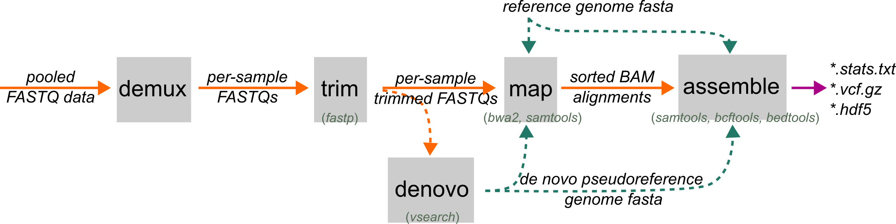

# demux

`ipyrad2 demux` splits pooled reads into per-sample FASTQ files by barcode or index. If your sequencing provider already delivered sample-specific FASTQ files, this step is unnecessary and you can proceed to [trim](./trim.md).

{ width="100%" }


## Overview
Demultiplexing is an optional step in ipyrad2 used to separate reads among samples that were pooled on a sequencing lane. We support demultiplexing using inline (internal) barcodes of fixed or variable length, including single-inline designs (barcode on one read) and dual-inline designs (barcodes on both reads), and we also support demultiplexing using external Illumina i7 index reads. Barcode mismatches can be tolerated up to an “off-by-n” limit, but only while the off-by-n barcode set remains unique (i.e., increasing n is disallowed once distinct barcodes become identical under the off-by-n expansion, typically at n ≥ 2).

Restriction cutsite motifs at the 5′ or 3′ end of single- or paired-end reads are auto-detected using fast k-mer analysis. Inline barcodes are parsed relative to the detected motif, and paired reads are evaluated jointly to improve sorting accuracy. Users can override the auto-detected motifs and will receive a warning if user-specified motifs disagree with the dominant patterns in the data. Reads that do not perfectly match one of the enumerated keys defined by the off-by-n map are assigned to an unassigned category. Demultiplexed reads are written as gzipped per-sample FASTQ files (R1 or R1/R2), and a summary statistics report counts reads assigned per sample and key.

## Prerequisites

- Pooled raw FASTQ files.
- A barcode or index table.
- A clear understanding of whether your run uses inline barcodes or `i7` indices.

## Inputs

### FASTQ inputs

Use `-d/--fastqs` with one or more raw FASTQ paths or shell-expanded globs.

```bash
ipyrad2 demux -d RAW/*.fastq.gz -b BARCODES.tsv
```

Multiple raw input files can be listed in one run. That is useful when a sample sheet should be applied across multiple lanes or technical replicate runs.

### Barcode table

The barcode table is whitespace-delimited, has no header, and should use:

```output
sample1  barcode1  barcode2
```

Example
```output
sample1  AATTCCGG   TTAACCGG
sample2  TTAAGGCC   AATTGGCC
...
```

The third column (`barcode2`) is optional. If it is present, ipyrad2 treats the table as combinatorial inline barcodes and requires paired-end reads. If barcodes are only present on read1 the second barcode column can be absent.

For `--i7` demux, only `barcode1` is used. If extra barcode columns are present, ipyrad2 ignores them in that mode.

If duplicate sample names appear in the barcode file, ipyrad2 treats them as technical replicates. You can either merge them with `-M/--merge-technical-replicates` or let ipyrad2 write them as separate samples with `-technical-replicate-N` appended to the names.

## Command Patterns

The simplest inline-barcode run is:

```bash
ipyrad2 demux -d RAW/*.fastq.gz -b BARCODES.tsv -o DEMUX/
```

### Core inputs

- `-d, --fastqs`: pooled FASTQ inputs
- `-b, --barcodes`: barcode/index table
- `-o, --out`: output directory, default `./DEMUX`
- `-f, --force`: overwrite demux outputs from the current run

### Demultiplexing mode

- `--i7`: demultiplex by i7 index instead of inline barcodes
- `-m, --max-mismatch`: allow barcode/index mismatches, from `0` to `2`
- `-M, --merge-technical-replicates`: merge replicated sample names into one output sample
- `--allow-leading-barcode-deletion`: for inline demux, recover exact observations missing the first expected barcode base, such as `CATGGTCA` for expected barcode `TCATGGTCA`

Use mismatches conservatively. Allowing mismatches can rescue reads from low-quality barcode positions, but it also increases the chance of ambiguous assignments when barcode sequences are too similar.

Leading-barcode-deletion rescue is disabled by default and is not implied by `--max-mismatch`. When enabled, ipyrad2 adds only the exact `barcode[1:]` candidate for each expected inline barcode. It does not add additional mismatch variants of that shortened candidate, and it is rejected if the rescue candidates make sample assignment ambiguous.

### Cutsite motifs

These options matter for inline demux:

- `-e1, --cutsite-1`: explicit R1 cutsite motif or motifs
- `-e2, --cutsite-2`: explicit R2 cutsite motif or motifs
- `-E, --disable-infer-cutsite-motifs`: skip motif inference
- `--max-reads-kmer`: reads sampled for motif inference, default `100000`

If you do not supply cutsite motifs, ipyrad2 tries to infer them from barcoded reads. That works well for standard libraries, but explicit motifs are better when:

- you already know the enzyme remnants
- you have a multi-enzyme design such as 3RAD
- inference is unstable on a small pilot dataset

### Performance and testing

- `-c, --cores`: maximum parallel workers, default `4`
- `-k, --chunksize`: maximum matched reads per batch, default `10000000`; batches also flush at 4 MiB
- `-x, --max_reads`: stop after N reads per file for a test run
- `--pigz`: compress temporary plain FASTQs with `pigz`
- `--tmpdir`: existing scratch directory for `--pigz`; defaults to private output staging

Python gzip is the default and writes compressed outputs directly, without disk-backed
handoff shards. Parallel runs use at most two readers and two writers; one input with
Python gzip uses one writer. A one-core run stays in the main process. More cores do
not necessarily improve performance on shared storage.

Reader batches are capped at 4 MiB or `chunksize` matched records. Each writer buffers
at most 16 MiB, flushing individual outputs at 1 MiB or earlier under memory pressure.
These are payload limits, with up to one incoming batch/record of overshoot; Python,
queue serialization, compression state, barcode maps, and process overhead consume
additional memory. Open output handles use a bounded LRU cache (at most 128 per writer,
reduced for the operating system's descriptor limit). Reopened gzip outputs may contain
multiple valid gzip members.

`--pigz` adds an uncompressed write and read before compression. It may help when CPU
compression is the bottleneck and local scratch is fast, but can be slower on shared
storage. Compression uses at most two jobs with one thread each. For example:

```bash
ipyrad2 demux -d RAW/*.fastq.gz -b BARCODES.tsv -o DEMUX --pigz --tmpdir /local/scratch
```

The scratch root must already exist. Demux creates and removes only its own private
subdirectory. Supplying `--tmpdir` without `--pigz` is an error. Ensure scratch has room
for the full uncompressed matched dataset.

All consumed FASTQ records are checked for four-line structure and equal sequence and
quality lengths. Paired inputs must have equal record counts and matching IDs after
normalizing `/1`, `/2`, and Illumina mate annotations. Invalid inputs fail with the file
and record number; they are not silently truncated. `--max_reads` validates only the
requested prefix. Mate pairing is preserved, but within-sample read order can vary
across concurrent input files. Compare decompressed read pairs, not compressed bytes.

### Logging

- `-l, --log-level`: logging verbosity

At normal verbosity, ipyrad2 reports the chosen demux mode, inferred or manual cutsite motifs, technical replicate handling, and where the demux stats file was written.

## Outputs

`demux` writes one FASTQ per sample mate:

- `SAMPLE_R1.fastq.gz`
- `SAMPLE_R2.fastq.gz` for paired-end data

Outputs and reports are written privately, then published after processing and file
closure succeed. `--force` preserves previous outputs until their replacements are ready.
Publication uses per-file atomic renames and a recovery manifest; the complete output
set is not atomically swapped. An interrupted publication must be recovered with
`--force`. Handled failures roll back and remove this run's staging files. Unrelated
files and previous numbered reports are preserved. A persistent `.ipyrad_demux.lock`
file coordinates runs sharing the destination directory.

With `--pigz`, plain FASTQs live only in private staging or the selected scratch directory.
An unclean shutdown can leave private run directories; do not delete a recovery manifest
before recovering its outputs.

It also writes a numbered demux report:

- `ipyrad_demux_stats_N.txt`
- `ipyrad_demux_stats_N.json`

That report includes:

- raw file statistics
- sample demux statistics
- suspected missing barcode statistics for frequent unassigned barcode-like observations
- barcode detection statistics
- restriction motif inference details for inline demux
- barcode-boundary ambiguity and collision details when relevant

If technical replicates are merged, the stats report includes both replicate-level information and merged-sample totals.

## Common Failures

### Barcode table cannot be parsed

The barcode file must be whitespace-delimited and sample names cannot contain spaces. If parsing fails, check the delimiter and remove spaces from sample names.

### Combinatorial barcodes with single-end data

If the barcode table contains both `barcode1` and `barcode2`, ipyrad2 expects paired-end reads. Using a combinatorial barcode table with single-end inputs is an error.

### Existing outputs block the run

If the destination directory already contains output files with the expected demux names, ipyrad2 stops unless `--force` is set.

### Ambiguous barcodes when mismatches are allowed

`--max-mismatch` can make distinct samples overlap in barcode space. When that happens, ipyrad2 warns that ambiguous barcodes will be assigned arbitrarily to the first matching sample. The safer fix is usually to lower the mismatch setting.

### Motif inference looks wrong

If inferred cutsite motifs do not match the library design, inline demux can fail or produce boundary collisions. Provide `--cutsite-1` and `--cutsite-2` explicitly when the enzyme remnants are known.

### Zero-read samples

ipyrad2 warns when a listed sample receives zero reads. That usually means the sample truly failed, the barcode table is wrong, or the demux mode does not match the run structure.

The demux stats report can also list suspected missing barcodes. These are frequent unassigned barcode-like observations supported by the expected index or cutsite structure. When one appears at high frequency, compare it to the barcode table; it often indicates a missing sample row, a typo, or an index/barcode assignment error. The report labels observations that exactly match a known barcode after dropping the expected barcode's first base as `leading_base_deletion`; rerun with `--allow-leading-barcode-deletion` only when that relationship matches the library design and the assignments remain unambiguous.

## Examples

### Basic inline-barcode demux

```bash
ipyrad2 demux -d RAW/*.fastq.gz -b BARCODES.tsv -o DEMUX/ -c 10
```

### Demultiplex by i7 index

```bash
ipyrad2 demux -d RAW/*.fastq.gz -b BARCODES.tsv --i7 -o DEMUX/
```

### Recover first-base-deleted inline barcodes

```bash
ipyrad2 demux -d RAW/*.fastq.gz -b BARCODES.tsv --allow-leading-barcode-deletion -o DEMUX/
```

### Merge technical replicates across runs

```bash
ipyrad2 demux -d RUN1/*.fastq.gz RUN2/*.fastq.gz -b BARCODES.tsv -M -o DEMUX/
```

### Set cutsite motifs manually

```bash
ipyrad2 demux -d RAW/*.fastq.gz -b BARCODES.tsv -e1 TGCAG -e2 CGG -o DEMUX/
```

### Test on a limited number of reads

```bash
ipyrad2 demux -d RAW/*.fastq.gz -b BARCODES.tsv -x 500000 -o DEMUX_TEST/
```

## Related Pages

- [Quick Guide](./index.md)
- [trim](./trim.md)
- [Files and Data Types](../getting-started/files-and-data-types.md)

Unmatched-barcode and boundary-ambiguity detail retains up to 4,096 distinct observations per input; additional distinct observations are counted in an explicit overflow row. Total reads remain exact. Suspected missing barcode counts remain bounded-memory estimates.

### Reproducible comparisons

`scripts/benchmark_demux.py` compares two source checkouts using the same input options.
Its optional `psutil` dependency is used only for measurement, not by demux. It records
elapsed time, sampled aggregate process RSS, sampled temporary disk usage, and SHA-256
multiset fingerprints of complete FASTQ records or read pairs, including duplicate
multiplicity. Compressed bytes and read order are not compared. Statistics must also
match. Use a frozen candidate checkout and avoid concurrent tests or jobs when timing.

```bash
python scripts/benchmark_demux.py \
  --baseline /path/to/baseline --candidate /path/to/candidate \
  --cases /path/to/cases.json --out /path/to/new-results \
  --cores 1 2 4 8 --repeats 3
```

The script's `--help` describes the case JSON format. `--synthetic --reads 100000`
generates the 96/384-sample, SE/PE, one/two-input, balanced/skewed matrix. Measurements
are local to the filesystem used; local NVMe results do not establish shared/HPC
performance. Summed RSS includes shared pages more than once, and sampled peaks can
miss short-lived allocations. Output staging with `--force` requires room for both the
old and new compressed outputs until publication completes.
