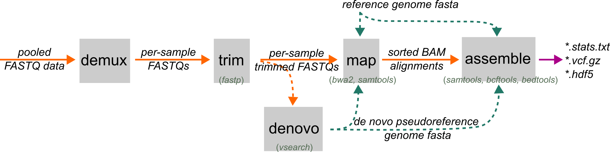

# denovo

`ipyrad2 denovo` is an optional step used to build a pseudoreference genome FASTA from trimmed sample FASTQs. It is used when you do not have a suitable external reference genome, or your samples are highly divergent and may be biased by using a single reference.

In the normal assembly workflow, `denovo` sits after [`trim`](./trim.md) and before [`map`](./map.md). Its main output is a pseudoreference FASTA that you can map reads against. It is not the final assembled dataset, and it does not replace the later [`assemble`](./assemble.md) step.

{ width="100%" }

## When to Use

Use `denovo` when: no suitable external reference genome exists; the available reference is too divergent to use confidently for read mapping; or you want to build a shared pseudoreference from the data themselves before mapping and assembly.

Do not use `denovo` when you already have a trusted reference FASTA that is appropriate for your samples. In that case, skip directly from [`trim`](./trim.md) to [`map`](./map.md).


## Overview

Reads are first clustered within samples at a high threshold (``--within-similarity``) to dereplicate and group reads representing alleles at the same locus into a consensus sequence. The consensus sequences are then clustered across samples at a lower threshold (``--across-similarity``) to group homologous loci, putatively including orthologs and paralogs. Using a similarity graph among samples, we apply a graph-splitting algorithm to separate duplicated components. The final set of graph components includes sets of sequences that include at most one sequence per sample, connected through accepted similarity edges; not every pair in a component must meet the similarity threshold. An alignment is performed on each set to generate a consensus that will serve as a locus in the pseudoreference. (See further details below).

## Prerequisites

Trimmed sample-level FASTQ or FASTQ.gz files, usually from [`trim`](./trim.md). All inputs in one run must be consistently single-end or consistently paired-end. (Note: you do not need to use all of your samples during this step, e.g., we recommend generally using 10-20 samples. You can still combine SE and PE data in the map stage using the pseudoreference assembled in this stage.)

## Command Patterns

The smallest useful run is:

```bash
ipyrad2 denovo -d TRIMMED/*.fastq.gz -o output-denovo
```

That tells `ipyrad2` to parse sample names from the FASTQ filenames, run the denovo clustering workflow, and write a curated pseudoreference output set to `output-denovo/`.

### Core Inputs

- `-d, --fastqs`: one or more FASTQ paths or glob patterns
- `-o, --out`: output directory, default `./output-denovo`
- `-f, --force`: overwrite denovo outputs created by this command
- `-b, --allow-reverse-complement`: cluster both strands rather than plus strand only

### Clustering and Consensus

- `-s, --within-similarity`: within-sample clustering threshold, default `0.95`
- `-S, --across-similarity`: across-sample clustering threshold, default `0.85`
- `-m, --min-derep-size`: minimum duplicate count retained during dereplication, default `5`
- `-i, --min-length`: minimum retained sequence length after merge or join, default `35`
- `-g, --min-merge-overlap`: minimum overlap required to merge paired reads, default `20`
- `-e, --max-merge-diffs`: maximum mismatches allowed in the merged region, default `4`
- `--no-alignment`: skip MAFFT and use longest-sequence selection while retaining paired-end arm handling

### Sample Naming

- `-dx, --delim-str`: delimiter used when parsing sample names
- `-di, --delim-idx`: index of the retained delimiter-split token

### Runtime

- `-c, --cores`: maximum total cores to use, default `6`
- `-t, --threads`: threads per `vsearch` job, default `3`
- `--imap`: optional IMAP file selecting all matching samples for denovo
- `--use-all-samples`: disable automatic downselection and use every parsed sample
- `--keep-intermediates`: retain the internal denovo working directory instead of cleaning it on success


## Workflow

1. parse sample names from input trimmed FASTQ (single or paired-end)
2a. (if paired-end): merge overlapping pairs and join unmerged pairs while recording spacer position
2b. dereplicate and cluster within samples to collapse into unique loci
3. write sample consensus fastas
4. cluster across-samples using vsearch all-by-all search among spacer-stripped consensus fastas
5. build graph of connected components
6. reconcile eligible same-sample records with direct support at or above the within-sample threshold (and required overlap), or identical sequences
7. split graph clusters into components using a maximum spanning forests algorithm
8. align sequences within each component using mafft and store the consensus as a pseudoreference locus
9. write pseudoreference loci to FASTA and write stats summary of graph splitting


## Performance

Two key parameter settings most significantly impact the runtime of the `denovo` step: `--imap` and `--min-derep-size`. Assembling a pseudoreference does not require every read from every sample. These options allow subselecting which samples and reads will be used to construct it.

### Dereplication

During this step, reads are dereplicated within each sample to retain only one copy of
each unique sequence, and reads that occur fewer than (`--min-dereplication-size`)
are discarded. This is an important heuristic. We find that a min dereplication size
of 5 typically performs well. For very low depth datasets you may want to reduce this.

### Sample selection

The goal of pseudoreference construction is to represent every ortholog in the dataset
by detecting it from at least one sample during this step. Analyzing and comparing
multiple samples increases the chances you will find more orthologs, and detect paralogs
that can be separated. However, there are usually diminishing returns from adding more and
more samples for this goal. Therefore, we recommend generally using ~10 of the most phylogenetically diverse, and high depth, samples in your dataset when running `denovo`.
Adding more samples can improve the result, but will increase runtimes non-linearly.

The current default auto-subsampling behavior is:

- keep all parsed samples when there are 10 or fewer
- when there are more than 10 samples, rank them by total input FASTQ size
- use the top 50% largest samples as the eligible pool
- if that pool has 10 samples, keep them all; if it has more than 10, randomly select 10
- if the eligible pool has fewer than 10 samples, fill the remaining slots from the next-largest samples until 10 are selected

You can override this in two ways:

- `--use-all-samples`: disable downselection and use every parsed input sample
- `--imap`: provide a two-column IMAP file and `denovo` will select all input samples matching its sample names or patterns

An IMAP lets you choose phylogenetically diverse builders explicitly. It does not automatically choose one representative per group. IMAP selection may exceed 10 builders, in which case `denovo` emits an advisory warning rather than truncating the set.


## Outputs and Intermediates

The primary result is the pseudoreference FASTA used for downstream mapping, named
`denovo_reference.fa`.

The `denovo` step also writes six curated outputs that can be optionally inspected.

- `denovo.stats.txt`: human-readable library summary, builder representation, group audit, settings, outputs, and timing/memory measurements
- `denovo.stats.json`: machine-readable scientific counters, parameters, provenance, and timing/memory measurements
- `denovo.loci.mapping.tsv`: mapping from final loci to the contributing sample-level consensus records
- `denovo.loci.stats.tsv`: per-locus summary table for the final denovo loci
- `denovo.sample_graph_summary.tsv`: per-sample burden of split, duplicated, and reconciled graph components
- `denovo.audit/`: compact audit files for duplicated, reconciled, or split components

`denovo.audit/` is intended for empirical diagnosis of difficult graph cases without requiring full intermediates to be preserved. In particular, `denovo.loci.mapping.tsv` and `denovo.loci.stats.tsv` expose reconciliation-related metadata such as the reconciliation mode and final output form, while the audit directory records per-component membership and summary information for duplicated components that were evaluated during graph refinement.

## Runtime and Performance Notes

- `--cores` controls total concurrency across the run.
- `--threads` applies to the `vsearch` stage.
- In the current implementation, the final MAFFT stage chooses its own worker scheduling internally from `--cores` and the number of loci.
- `--no-alignment` is usually much faster on large datasets because it skips MAFFT entirely in the last stage.

## Common Failures and Interpretation Notes

### Mixed single-end and paired-end inputs

One run must be consistently SE or consistently PE. Mixed layouts are rejected.

### Invalid clustering or merge parameters

`denovo` validates the similarity thresholds and length or overlap settings before launching work. For example:

- similarity thresholds must be greater than `0` and less than or equal to `1`
- dereplication size and minimum lengths must be at least `1`
- maximum merge differences must be at least `0`

### Existing outputs already exist

If curated denovo outputs already exist in the output directory, `denovo` stops unless you provide `--force`.

### Denovo output is not the final project output

`denovo_reference.fa` is a pseudoreference for mapping. It is not the final assembled HDF5, VCF, or loci dataset. The normal next step is [`map`](./map.md), followed by [`assemble`](./assemble.md).


## Examples

### Basic denovo pseudoreference build

```bash
ipyrad2 denovo -d TRIMMED/*.fastq.gz -o output-denovo
```

### Use custom similarity settings and more concurrency

```bash
ipyrad2 denovo -d TRIMMED/*.fastq.gz -o OUT -s 0.95 -S 0.85 -c 12 -t 3
```

### Use delimiter-based sample naming

```bash
ipyrad2 denovo -d TRIMMED/*.fastq.gz -o OUT -dx _R -di 1
```

### Keep intermediate files for inspection

```bash
ipyrad2 denovo -d TRIMMED/*.fastq.gz -o OUT --keep-intermediates
```

### Skip final alignment and write longest-sequence representatives

```bash
ipyrad2 denovo -d TRIMMED/*.fastq.gz -o OUT --no-alignment
```

### Empirical example

See the [Empirical SE denovo tutorial](tutorial-ped.md) for an example run on real data.

## Related Pages

- [Quick Guide](./index.md)
- [trim](./trim.md)
- [map](./map.md)
- [assemble](./assemble.md)

### MAFFT on shared HPC filesystems

MAFFT uses shell helper programs as well as its native alignment binaries. The
MAFFT child process receives its own environment and working directory, including
when the selected MAFFT executable has an absolute Conda path. On Linux, when the
environment's `awk` resolves to recognized shared storage, ipyrad2 checks a local
system awk and puts local system helpers first in the child's PATH. The parent
Conda environment and MAFFT alignment arguments remain unchanged.

MAFFT uses a private local temporary directory. Existing local `MAFFT_TMPDIR`,
`SLURM_TMPDIR`, and `TMPDIR` locations are preferred in that order; recognized
network locations are skipped. A failed invocation retains its input FASTA and
runtime metadata in that directory and logs its path for replay. Successful
private scratch is removed. This does not retry a failed alignment automatically
or change its scientific parameters. Filesystem detection is Linux-specific;
unknown filesystems retain the selected environment helpers.

For a shared Conda MAFFT installation, ipyrad2 also copies its launcher and
native program directory to private node-local storage once per process. It
checks every copied file against the source SHA256 and sets `MAFFT_BINARIES`
only in the child environment. This avoids repeatedly opening the launcher and
native programs over the shared filesystem. The copied program contents and
scientific arguments are unchanged. The small runtime bundle and its source
manifest are retained and their location is logged. A shared nonstandard
installation must provide its native program directory via `MAFFT_BINARIES`.

## Run safety and profiling

Inputs, pairing, sample selection and required executables are checked before
preparing a new output attempt. Each run writes into a unique
`.denovo-attempt-ID` directory under the output directory. With `--force`, the
previous published reference and tables remain available while the new run is
computing. A successful run publishes the new files, retaining `_denovo_work`
only with `--keep-intermediates`. Unrelated files are left alone.

A failure after preflight retains its attempt directory, remaining intermediate files and a
`FAILED` `denovo.stats.txt`/`.json` report. It does not replace the previous
successful outputs. Publication uses atomic file renames, a journal, and rollback
for ordinary errors; it is not an atomic snapshot of the whole directory.
A `.denovo.lock` prevents simultaneous writers. After an abrupt machine failure
or SIGKILL, inspect the lock, attempt, `PUBLICATION.json` and any `_previous`
backup before taking recovery action. Runs never blindly resume an old attempt.
If publication rollback itself fails, the attempt report is marked
`RECOVERY_REQUIRED` and the lock is retained; the output directory must be
inspected before its files are used or another run is started.

Run reports use statistics schema `2.0`. The text report follows the trim and
assemble conventions: a short command, aligned sections and tables, explicit
units, percentages with denominators, and `N/A` for unavailable values. The
reference-library summary comes first; timing and memory details follow the
scientific summary. JSON retains the full argv as received,
shell-quoted invocation, resolved parameters, input/selected-sample mapping,
tool versions, UTC timestamps, completion state, and numeric stage measurements.
Stage timings cover preflight, within-sample clustering, combining summaries,
across-sample search, graph processing, alignment, final QC, summary writing and
cleanup. The run timing ends before publication of these reports.

The report distinguishes **builders** (selected samples used to construct the
library), **input representative sequences** (seeds/cores from within-sample
read clusters), **similarity groups** (graph components), and output **reference
loci**. Sequence-to-locus memberships count mapping-table rows, not FASTA
entries. Builder representation is measured before downstream mapping of all
samples; it does not describe whole-cohort coverage or genotype completeness.
The group audit covers only groups with same-builder duplicates or oversized
groups. Its processed-group counts and size quantiles are explicitly labeled as
that subset. Large unsplit placeholders are included in the reference count and
identified separately; they are not resolved individual loci.

Scientific counters remain available in JSON, with a
`definitions` dictionary explaining their interpretation. Text fractions use
percentages; undefined denominators and uncomputed alignment categories display
`N/A`. Detailed counters and complete output paths remain available in JSON.

On Linux, memory is sampled every 0.25 seconds and at each stage boundary. The
reported value is the largest sampled sum of RSS for the process and its live
descendants, including Python pool workers and native tools. Shared memory may be
counted more than once, and brief peaks between samples may be missed. This is
not a scheduler MaxRSS, not a lifetime high-water-mark difference, and stage
values must not be added together. Unsupported or unavailable measurements are
`null` in JSON and `N/A` in text. Sample counts and unavailable-sample counts are
recorded so measurement coverage is explicit.

The graph stage also records execution details in its JSON `details` field
(schema `1.0`), with a compact summary in the text report. These include input
and component counts, worker batches, peak buffered components, sequential
preparation phases, parent table/audit writing and stream flushing time,
dispatch/collection time, and summed worker computation and CPU time. Dispatch/collection includes pool
startup/shutdown, waiting, serialization and result transport; job construction
is included in this interval and reported separately. Worker computation can
overlap parent activity and other workers, so these measurements must not be
added together as a wall-time breakdown. Parent writing includes formatting
and buffered writes, not guaranteed physical-disk write time. Detailed graph
measurements describe completed graph stages; a failed stage retains its usual
failure status and stage-level measurements.

Small graph components share bounded worker batches to reduce dispatch overhead.
A batch contains at most 32 components, 256 nodes, 65,536 sequence bases and
4,096 edges. A single component above a transport budget runs alone with its
original graph rules; these budgets never discard or split biological data.
Smaller inputs use smaller batches to retain parallelism. The audit summary
uses one open stream, flushed after each completed batch. Canonical mapping,
locus IDs and scientific decisions retain their original order. Graph batches
are delivered in input order, with running and completed-but-unconsumed batches
limited to twice the worker count. Older audit summaries used completion order;
join their rows by `component_id` when comparing runs.

The alignment stage records its own `details` schema `1.0`. JSON separates
summary loading, planning, job preparation, ordered FASTA writing, and
dispatch/collection from summed worker times for MAFFT setup/cleanup,
launch/execution, output parsing, and consensus construction. Actual MAFFT
invocations, successes and failures are counted: a paired-end or reconciled
locus may require several invocations. A bounded histogram records complete
call durations in seconds, including failed attempts, with explicit bin upper
bounds (the final `null` means no upper bound). Empty duration summaries are
`null`, not zero. The text report shows the main counts and timings.

The alignment scheduler admits at most twice the MAFFT worker count in
outstanding loci, including both running jobs and completed results awaiting
their turn in the FASTA. It also reserves at most 8 MiB of output payload,
using the input sequence lengths plus the output spacer and locus name as a
conservative bound. A locus larger than this budget runs intact and alone.
These limits do not change MAFFT arguments, consensus rules, or locus order.
They can pause new submissions behind a slow earlier locus, trading some
worker utilization for bounded output accumulation. Backpressure events and
waiting time are reported, along with peak outstanding loci, completed-result
count, actual buffered payload bytes and reserved payload bytes.

The byte budget covers UTF-8 locus names and consensus strings, **not total
memory**: Python object overhead, the loaded sequence catalogue, plans, one
lookahead input record, and MAFFT workspace are separate. Use sampled process
tree RSS to assess overall memory. MAFFT launch/execution includes subprocess
launch and waiting, not native CPU time alone. Dispatch/collection includes
job preparation and ordered writing; worker timings overlap across loci and
with parent activity. Do not add these measurements as a wall-time breakdown.
Alignment details gathered before a failure remain in the failed run report.

Single-end loci use the ordinary consensus path even when older mapping tables
label a reconciled group as `spaced`. Compatible records in a same-sample
contract group are first reduced to one sequence; the locus consensus is then
constructed from those group sequences. Reconciliation alone does not imply
paired-end arms or an output spacer.

The spacer counts in `denovo.stats.txt` and `denovo.stats.json` describe padding
actually inserted in completed output sequences, including any fallback during
alignment. Joined-only PE, mixed PE and no-spacer counts sum to the number of
written loci. Naturally occurring ambiguity Ns do not count as inserted spacers.

### Reverse-complement orientation

`--allow-reverse-complement` enables both-strand search within and across
samples. With this option, final mapping rows include an `orientation` column.
A deterministic maximum-support forest orients seeds using identity, coverage,
and stable input order; each output locus is anchored on its earliest core.
Conflicting weaker orientation edges are counted in
`denovo.audit/orientation.json`. This establishes sequence coordinates, not an
orthology guarantee. Reversing a joined sequence also swaps its left and right
arms and adjusts the arm boundary before consensus construction. The ordinary
plus-strand workflow retains its existing sequences, locus IDs, mapping columns,
and graph decisions.

The sparse graph implementation visits existing edges and preserves canonical
edge order, maximum-score selection and deterministic tie rules. It does not
change similarity thresholds, sample selection, reconciliation rules, oversized
component placeholders or the majority-base consensus policy.

Sample summaries are concatenated in sorted filename order using 4,096-row
chunks. Component edge dictionaries are allocated only for components with
edges and released from the parent catalogue as jobs take ownership. These
changes preserve table serialization and graph decisions. Graph batches are
delivered in component order, with running and completed-but-unconsumed
batches together limited to twice the worker count. Existing batch budgets
and component boundaries are preserved. This bound can pause submissions
behind a slow component; it limits result accumulation, not total process
memory. Worker failures are checked even when an earlier batch is unfinished.
