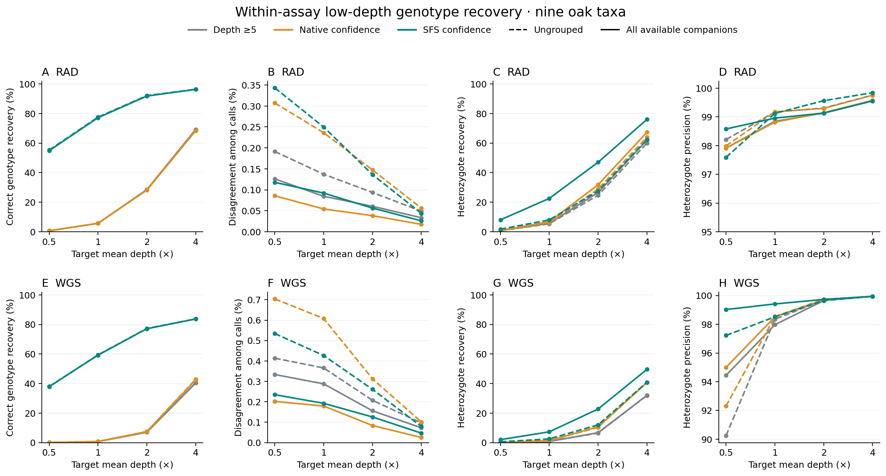

# Mixed-depth SFS calling and diversity: a paper example

> **Documentation draft for review.** The commands describe the public SFS
> features. Numerical results and the figure come from the paper's completed,
> validated analyses. They are examples of performance on those data, not
> promised accuracy for a new library.

Mixed RAD and WGS datasets raise two different questions: which genotypes are
confident enough to export, and how much diversity is supported by the reads,
including uncertain genotypes? `assemble` addresses the first question;
likelihood-based `popgen` addresses the second. RAD samples define the locus
domain, and WGS samples contribute evidence inside those intervals.

## Choose the output you need

| Task | Options | Result |
|---|---|---|
| Existing assembly behavior | `assemble --genotype-model native` | Native calls with the usual default depth floor of 5 |
| Confidence-based assembly | `assemble --genotype-model sfs` | SFS posterior calls, default depth floor 1, with rejected cells masked |
| Retain evidence for diversity | `assemble --evidence loci` | Native likelihoods across final retained locus bases |
| Diversity from accepted calls | `popgen --genotype-mode calls` | Statistics from the canonical genotypes/sequences |
| Diversity integrating uncertainty | `popgen --genotype-mode likelihoods --evidence-scope loci --evidence-prior sfs` | Posterior heterozygosity and sampled-chromosome diversity |

The caller and evidence-storage options are independent. Native assembly can
retain evidence for later SFS summaries, and SFS assembly can write a lean
database. Neither public SFS option applies the paper's separate observation
calibration for allele imbalance and correlated errors.

## Prepare a small oak cohort

The paper's *Quercus alba* comparison used RAD focal SRR5284372, RAD companions
SRR5284373 and SRR5284374, and WGS individual SRR16661075. These are distinct
individuals. An illustrative `alba.populations.tsv` is:

```text
SRR5284372	alba
SRR5284373	alba
SRR5284374	alba
SRR16661075	alba
```

Use tab-separated fields. Names must match the resolved assembly sample names;
the example assumes BAM filenames and sample identifiers match these accessions.
All BAMs must use the same reference and coordinates. Here, `retained-rad-loci.bed`
is a previously defined RAD locus domain, and the BAMs are already mapped and
quality filtered. A prepared low-depth BAM can replace one focal BAM without
including its full-depth version as a second individual.

Taxon membership is a biological grouping assumption, not proof of panmixia.
For a singleton comparison, omit `--populations` during assembly. With a mapping
file, every input sample must belong to exactly one group. Additional individuals
can help estimate a prior, but cohort size and assay type are not interchangeable
controls: changing individuals also changes their genotypes and read evidence.

## Assemble with SFS confidence

```bash
ipyrad2 assemble \
  -d BAMS/RAD/SRR5284372.bam BAMS/RAD/SRR5284373.bam BAMS/RAD/SRR5284374.bam \
  -w BAMS/WGS/SRR16661075.bam \
  -r REF.fa --loci-bed retained-rad-loci.bed \
  -o OUT_SFS -n alba --populations alba.populations.tsv \
  --genotype-model sfs --min-locus-depth 5 -s 1 -qg 13 -qs 13 \
  --sfs-fit-loci 1024 --sfs-folds 5 --evidence loci \
  -m 1 -a 1 -c 4 -t 1
```

For this small demonstration, `-m 1 -a 1` permits loci and edges represented by
one sample. Set these final retention requirements for your study. Supplying a
BED bypasses RAD-based locus discovery, including `--min-locus-depth`, but final
locus and sample filters still apply. Without a supplied BED, discovery depth
defaults to 5 in SFS mode; genotype acceptance still defaults to depth 1.

`-qg 13` requires about 95% posterior genotype confidence. For a stricter nominal
99% threshold, use `-qg 20` in a separate output directory. The depth floor and
confidence requirement both apply. Increasing `-s` does not make the SFS fitter
skip low-depth evidence. No reads means no call; a prior alone cannot fill a
zero-read cell. Unnamed alternatives cannot become invented nucleotide calls.
Unsupported indels and multiallelic records use conservative native fallback.

Inspect `alba.stats.txt`, `alba.stats.json`, and `alba.sfs.json` for resolved
thresholds, group membership, fitting loci, convergence, acceptance counts, and
stage times. A failed or uninformative SFS fit stops explicitly. The standard
VCF and locus sequences contain accepted calls; the HDF5 also retains the
likelihoods requested by `--evidence loci`.

For a native baseline, run the same inputs and grouping to a new directory with
`--genotype-model native -s 5`, omitting the SFS fitting options. Final retained
domains may differ between callers. A controlled method comparison must match
coordinates, allele axes, masks, and comparator eligibility rather than compare
unmatched output averages.

## Estimate heterozygosity and diversity from the same database

These commands provide three useful summaries. Each keeps the assembly database
unchanged and writes to a separate directory:

```bash
# Hard-call baseline: counts only the accepted canonical genotypes.
ipyrad2 popgen -d OUT_SFS/alba.hdf5 -i alba.populations.tsv \
  -o POPGEN_CALLS -n alba --genotype-mode calls --stats heterozygosity,pi

# Uniform genotype prior: a diagnostic baseline for prior sensitivity.
ipyrad2 popgen -d OUT_SFS/alba.hdf5 -i alba.populations.tsv \
  -o POPGEN_UNIFORM -n alba --genotype-mode likelihoods --evidence-scope loci \
  --evidence-prior uniform --stats heterozygosity,pi --min-genotype-depth 1

# Fitted SFS: integrates uncertainty without first thresholding genotypes.
ipyrad2 popgen -d OUT_SFS/alba.hdf5 -i alba.populations.tsv \
  -o POPGEN_SFS -n alba --genotype-mode likelihoods --evidence-scope loci \
  --evidence-prior sfs --stats heterozygosity,pi --min-genotype-depth 1 \
  --sfs-fit-loci 1024 --sfs-folds 5 -c 4
```

The first command summarizes **SFS-accepted hard calls**, since that is what this
database contains. To summarize the native depth-five baseline, use its separate
database. These commands do not automatically intersect the hard-call and
likelihood domains; inspect and match denominators before attributing a
difference to the estimator alone.

`alba.sample_stats.tsv` reports individual heterozygosity and usable-cell counts.
`alba.population_stats.tsv` reports cohort diversity and its callable-base
denominator. In likelihood mode, heterozygosity is the mean posterior probability
of a heterozygote. Diversity integrates the joint allele-count distribution,
including covariance induced by the shared prior; it is not calculated from
rounded dosages. `alba.sfs.tsv` contains fitted group/fold weights, and
`alba.manifest.txt` records the analysis assumptions and filters.

Both commands use whole-locus cross-fitting, but their fitting budgets differ:
assembly selects up to 1,024 eligible training loci **per group and held-out
fold**, whereas `popgen` selects up to 1,024 fitting loci **in total** before
excluding the evaluation fold. `popgen` refits its own prior; it does not import
the assembly weights. This preserves the procedures used by the respective
validated workflows.

All-base likelihood summaries include eligible reference/`<*>` observations as
a conditional biallelic model with an unnamed alternative. They exclude
unsupported or missing observations rather than counting them as homozygous
reference. The denominator is callable bases in retained RAD loci, not the
whole genome. Likelihoods can contribute even when confidence was insufficient
for a hard call, provided the cell passes evidence and domain filters.

## What the paper's oak experiment demonstrates

The within-assay experiment thinned one RAD and one WGS library for each of nine
oak taxa: *Q. alba*, *Q. chrysolepis*, *Q. dentata*, *Q. engelmannii*,
*Q. mongolica*, *Q. petraea*, *Q. robur*, *Q. tomentella*, and *Q. vacciniifolia*.
Four target depths (0.5×, 1×, 2×, 4×) and three technical seeds produced 216
conditions across 33,052 retained RAD loci (6,027,551 bases). Each low-depth
library was compared with stringent full-depth calls **from the same library**.
Companion evidence remained fixed within each controlled comparison.



*Paper figure draft: medians across nine taxa after combining technical seeds
within each focal. Solid lines use all prespecified companions; dashed lines use
singleton groups. The orange native-confidence policy is a research comparator,
not another public `--genotype-model` choice. The two assay panels have different
depth distributions and filtering histories, so their separation is not an
assay-superiority test.*

Selected results at genotype-confidence threshold 13, with all prespecified
companions, are:

| Assay | Target depth | Correct recovery, depth-five baseline | Correct recovery, SFS | Disagreement among SFS calls |
|---|---:|---:|---:|---:|
| RAD | 1× | 5.68% | 77.20% | 0.092% |
| WGS | 1× | 0.69% | 59.23% | 0.192% |
| RAD | 4× | 69.20% | 96.36% | 0.026% |
| WGS | 4× | 40.41% | 83.72% | 0.047% |

Correct recovery includes labelled bases that receive zero low-depth reads;
disagreement is conditional on an exported call at a labelled base. These are
medians of focal rates, not fractions of the entire genome. Comparator labels
required depth 10–200, strong likelihood support and independent native-call
agreement; heterozygote labels also required both alleles to be observed. Full
depth is an empirical comparator, not known biological truth. A complementary,
nonoverlapping-read sensitivity gave similar curves on its common eligible
domain.

Cohorts helped particularly with heterozygote recovery. At 1×, singleton-to-group
median recovery increased from 7.99% to 22.53% for RAD and from 2.50% to 7.27% for
WGS. Grouping reduced overall disagreement in all 72 paired focal-depth
contrasts, but slightly reduced overall correct recovery and did not uniformly
improve heterozygote precision. Confidence therefore changes a sensitivity and
specificity tradeoff; it does not guarantee recovery of every low-depth genotype.
Within-library RAD comparisons also cannot detect dropout already shared by all
reads in that library.

The displayed results were produced with frozen research captures, masks, and
evaluation scripts. The public commands above demonstrate the implemented
workflow; they do not recreate all 216 conditions or the paper's matched-domain
bootstrap analysis. Changing the BAM cohort and rerunning pileup can change
native likelihoods even for unchanged read files. The integrated caller was
checked separately against frozen functions and bounded oak/cranolopha vectors.

## How this relates to the diversity and calibration analyses

The paper also assessed heterozygosity and cohort diversity using known-genotype
simulations and same-DNA assay substitutions. Those experiments motivate
retaining likelihoods instead of using only confident calls. They also tested a
separate, library-specific observation model for read quality, correlated error,
and allele imbalance, followed by an SFS prior. **That full correction is a
research workflow, not an effect of either public SFS flag shown above.**

At simulated depth 24 under 80:20 imbalance, heterozygosity bias was −0.168
percentage points for hard calls, −0.116 for uncalibrated SFS, and +0.012 for full
correction plus SFS. Diversity biases were −0.020, −0.015, and +0.004 percentage
points. Correction was less reliable in some low-depth/error controls and could
not uniformly recover complete allele loss.

For empirical comparisons, the focal RAD assay was substituted for the same
individual's WGS assay while companions and evaluation cells were fixed. The
following signed RAD-minus-WGS differences are in **percentage points**:

| Individual | Role | H, uncalibrated SFS | H, corrected SFS | π, uncalibrated SFS | π, corrected SFS |
|---|---|---:|---:|---:|---:|
| *Q. mongolica* | Development | −0.125 | +0.034 | −0.030 | +0.035 |
| *Q. petraea* | Development | −0.138 | +0.006 | −0.026 | +0.005 |
| DE590 | Development | −0.756 | −0.079 | −0.348 | −0.081 |
| DE414 | Development | −0.882 | −0.184 | −0.399 | −0.139 |
| DE177 | External validation | −1.084 | −0.082 | −0.906 | −0.249 |
| DE350 | External validation | −0.714 | +0.737 | −0.489 | +0.668 |

DE177 and DE350 received a frozen calibration trained on DE590. Paired
whole-locus intervals supported improvement in both statistics for DE177, while
DE350 overcorrected in sign and did not resolve improvement or worsening in
absolute disagreement. Neither oak population-diversity contrast resolved an
improvement. In DE177, large opposing named- and unseen-site contributions
partly cancelled, so a small total difference was not evidence of calibration
in both categories. These comparisons test assay agreement, not biological
truth or universal transfer to new libraries.

Cranolopha preprocessing used random i5 tags and mapping geometry to identify
UMI duplicate families; read starts alone were insufficient for RAD duplicates.
The frozen model did not include a UMI-family likelihood. The public SFS prior
itself does not require UMIs or paired RAD/WGS assays. Each individual must enter
a cohort once; same-DNA RAD and WGS assays are alternative representations,
not two donors.

## Inspect the source summaries

- [Oak calling summary](mixed-depth-sfs-example/oak-calling-summary.tsv): exact
  selected aggregate rates, including heterozygote recovery and precision.
- [Calibration transfer summary](mixed-depth-sfs-example/calibration-transfer-summary.tsv):
  signed gaps, absolute-gap reductions, and paired whole-locus intervals.
- [Provenance](mixed-depth-sfs-example/provenance.json): source package, source
  hashes, and the selection rules for these documentation assets.

The summary tables and figure are copied or selected from the validated paper
package `mixed-assay-genotypes-diversity-2026-11-19`. They contain aggregate
results, not the raw reads or a complete downloadable reproduction dataset.
Technical seeds remain grouped within locus resampling; intervals condition on
the fitted priors and calibration parameters.

See the [assemble reference](../assembly/assemble.md#opt-in-sfs-confidence-calling)
and [popgen reference](../analyses/popgen.md#opt-in-fitted-sfs-prior) for the full
option, missingness, allele-model, and output definitions.
